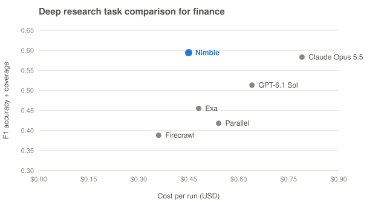

# Benchmark: hedge fund company research

<picture>
  <source media="(prefers-color-scheme: dark)" srcset="../assets/benchmark-chart-dark.svg">
  
</picture>

*Finance Use-Case Benchmark v2, 40 tasks, November 2026. Higher and further left is better.*

How well do web research agents do the jobs these skills are for? This page summarizes Nimble's public **Finance Use-Case Benchmark v2** (runs November 3 to 10, 2026; judged November 10; corrections November 11). The full method, task instructions, raw provider outputs, verdicts and answer keys are in [Nimbleway/Public-benchmarks/Finance-Use-Case-Benchmark](https://github.com/Nimbleway/Public-benchmarks/tree/main/Finance-Use-Case-Benchmark); the numbers below are copied from its `results/summary.json`.

## How it is scored

Every provider gets the same instructions and output schema for a job. A judge (Claude Sonnet 5.5) breaks each answer into atomic facts, fetches every page any provider cited, and marks each fact true, wrong, off scope or unverifiable. Then:

- **Coverage**: weighted share of all facts verified true (from any provider) that this provider found. Critical facts weigh 6, useful 2, minor 0.5, and x1.5 when fresh.
- **Accuracy**: weighted share of the provider's own facts that were right (unverifiable counts as half wrong).
- **Combined**: F1 of accuracy and coverage, scaled by how many critical answer-key questions the provider got right. The answer keys were written by a separate run before any provider output was seen.
- **Critical key items correct**: share of those critical answer-key questions answered correctly.

All providers ran at their high tier. The four research APIs are matched on list price per run (about $0.50); GPT-6.1 Sol and Claude Opus 5.5 run with their own web tools at high effort.

## Hedge fund company research (5 tasks)

The job: "Research <company> for a hedge fund", returning catalysts, results against guidance, event-driven items, credit and alternative-data signals, insider moves and risks, each sourced. Inputs: NVIDIA, Tesla, Boeing, Peloton, Carvana.

| Provider | Combined | Accuracy | Coverage | Critical key items correct | Facts (true / wrong) | Wins | Cost / run |
| :--- | :---: | :---: | :---: | :---: | :---: | :---: | :---: |
| Claude Opus 5.5 | **0.608** | 0.973 | 0.454 | 0.967 | 210 / 6 | 3/5 | $1.07 |
| Nimble | 0.573 | 0.962 | 0.408 | **1.000** | **221** / 12 | 2/5 | $0.50 |
| GPT-6.1 Sol | 0.487 | 0.995 | 0.364 | 0.833 | 164 / 2 | 0/5 | $0.64 |
| Firecrawl | 0.403 | 0.983 | 0.270 | 0.900 | 126 / 4 | 0/5 | $0.14 |
| Exa | 0.397 | 1.000 | 0.275 | 0.900 | 120 / 0 | 0/5 | $0.50 |
| Parallel | 0.373 | 0.996 | 0.269 | 0.793 | 120 / 1 | 0/5 | $0.60 |

Combined score per input:

| Input | Nimble | Claude Opus 5.5 | GPT-6.1 Sol | Exa | Parallel | Firecrawl |
| :--- | :---: | :---: | :---: | :---: | :---: | :---: |
| NVIDIA | 0.593 | **0.602** | 0.491 | 0.236 | 0.322 | 0.367 |
| Tesla | **0.564** | 0.543 | 0.392 | 0.364 | 0.325 | 0.383 |
| Boeing | 0.578 | **0.615** | 0.513 | 0.397 | 0.331 | 0.450 |
| Peloton | 0.562 | **0.733** | 0.508 | 0.559 | 0.450 | 0.494 |
| Carvana | **0.569** | 0.545 | 0.531 | 0.427 | 0.435 | 0.321 |

Accuracy, coverage and the fact counts are means and sums over the five tasks.

Read it this way: Nimble returned the most verified facts and was the only provider to get every critical answer-key question right, at half the cost of Claude Opus 5.5. Opus scored higher overall, mostly on Peloton. The API-only providers were very precise but found roughly a quarter of what the pool found.

## All eight finance jobs (40 tasks)

| Provider | Combined | Accuracy | Coverage | Critical key items correct | Wins | Avg cost / run | Median seconds |
| :--- | :---: | :---: | :---: | :---: | :---: | :---: | :---: |
| Nimble | **0.594** | 0.920 | **0.485** | 0.948 | 14/40 | $0.45 | 269 |
| Claude Opus 5.5 | 0.583 | 0.932 | 0.464 | **0.970** | 19/40 | $0.79 | 194 |
| GPT-6.1 Sol | 0.513 | 0.975 | 0.408 | 0.848 | 5/40 | $0.64 | 323 |
| Exa | 0.455 | 0.977 | 0.349 | 0.858 | 1/40 | $0.48 | 177 |
| Parallel | 0.418 | **0.982** | 0.323 | 0.820 | 1/40 | $0.54 | 522 |
| Firecrawl | 0.388 | 0.945 | 0.300 | 0.774 | 0/40 | $0.36 | 222 |

Combined score by job (mean of 5 tasks):

| Job | Nimble | Exa | Parallel | Firecrawl | GPT-6.1 Sol | Claude Opus 5.5 |
| :--- | :---: | :---: | :---: | :---: | :---: | :---: |
| Investment due diligence | **0.522** | 0.382 | 0.334 | 0.329 | 0.468 | 0.486 |
| Credit and counterparty risk | **0.579** | 0.440 | 0.426 | 0.360 | 0.511 | 0.567 |
| KYC, AML and compliance screening | 0.815 | 0.621 | 0.725 | 0.620 | 0.755 | **0.837** |
| Deal sourcing and market mapping (F2) | **0.536** | 0.249 | 0.297 | 0.209 | 0.370 | 0.220 |
| Hedge fund company research | 0.573 | 0.397 | 0.373 | 0.403 | 0.487 | **0.608** |
| Answer a current question with sources | **0.745** | 0.520 | 0.412 | 0.538 | 0.601 | 0.730 |
| Adverse media investigation | 0.502 | **0.565** | 0.424 | 0.286 | 0.493 | 0.514 |
| Investment thesis testing | 0.479 | 0.466 | 0.356 | 0.358 | 0.423 | **0.706** |

## Caveats

- Five inputs per job and one run per provider per task; small differences are within run-to-run noise.
- Nimble wrote the jobs, inputs and instructions. The Nimble arm was rerun on November 9 to 10, after Nimble's November extract-template release; the others ran once between November 3 and 10.
- Coverage is relative to what the six providers found together, not an exhaustive answer set.
- The judge and answer-key writer are Claude models, and Claude Opus 5.5 is a contestant. Nimble Extract is one of four page fetchers the judge uses for every provider's citations.
- The benchmark ran Nimble's general Web Search Agent with the benchmark's own instructions and schema, not the `hf-*` agents in `skills/company-deep-research/agents/`.
- Verdicts and keys are model judgments, not reviewed by finance practitioners. See the source README for the full list and the corrections log.

To recompute the tables offline, clone the source repo and run `python -m usecase_bench.summary` in `Finance-Use-Case-Benchmark/`.
